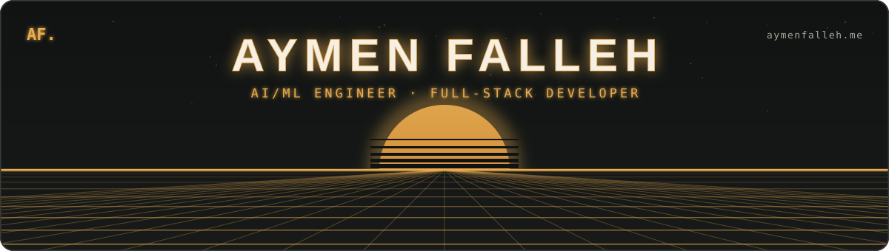
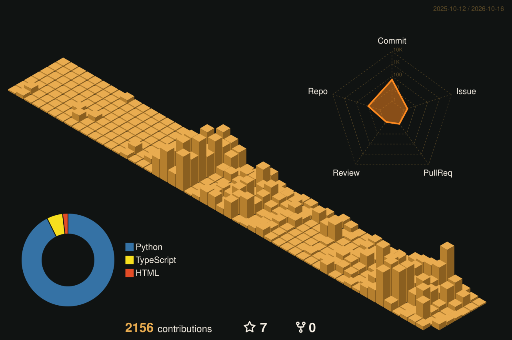

<picture>
  <source media="(prefers-color-scheme: dark)" srcset="https://readme-typing-svg.demolab.com?font=JetBrains+Mono&weight=600&size=22&duration=2800&pause=900&color=E9AC50&center=true&vCenter=true&width=820&height=48&lines=Got+an+idea%3F;I+build+the+system+that+makes+it+real.;I+learn+fast%2C+then+ship+useful+AI.;Whatever+it+takes.+Shipped." />
  <source media="(prefers-color-scheme: light)" srcset="https://readme-typing-svg.demolab.com?font=JetBrains+Mono&weight=600&size=22&duration=2800&pause=900&color=A8650F&center=true&vCenter=true&width=820&height=48&lines=Got+an+idea%3F;I+build+the+system+that+makes+it+real.;I+learn+fast%2C+then+ship+useful+AI.;Whatever+it+takes.+Shipped." />
  
</picture>

  

### `$ ls stack/`

<table align="center">
  <tr>
    <td align="right"><b>AI / ML</b></td>
    <td align="left">
      
      
      
      
      
    </td>
  </tr>
  <tr>
    <td align="right"><b>Web</b></td>
    <td align="left">
      
      
      
      
    </td>
  </tr>
  <tr>
    <td align="right"><b>Data</b></td>
    <td align="left">
      
      
      
    </td>
  </tr>
  <tr>
    <td align="right"><b>Tools</b></td>
    <td align="left">
      
      
      
    </td>
  </tr>
</table>

Also: LangChain · LLMOps · MCP · MLOps · Pinecone · Explainable AI · GNNs

### `$ git log --stat`

<picture>
  <source media="(prefers-color-scheme: dark)" srcset="./dist/snake-dark.svg" />
  <source media="(prefers-color-scheme: light)" srcset="./dist/snake-light.svg" />
  
</picture>

